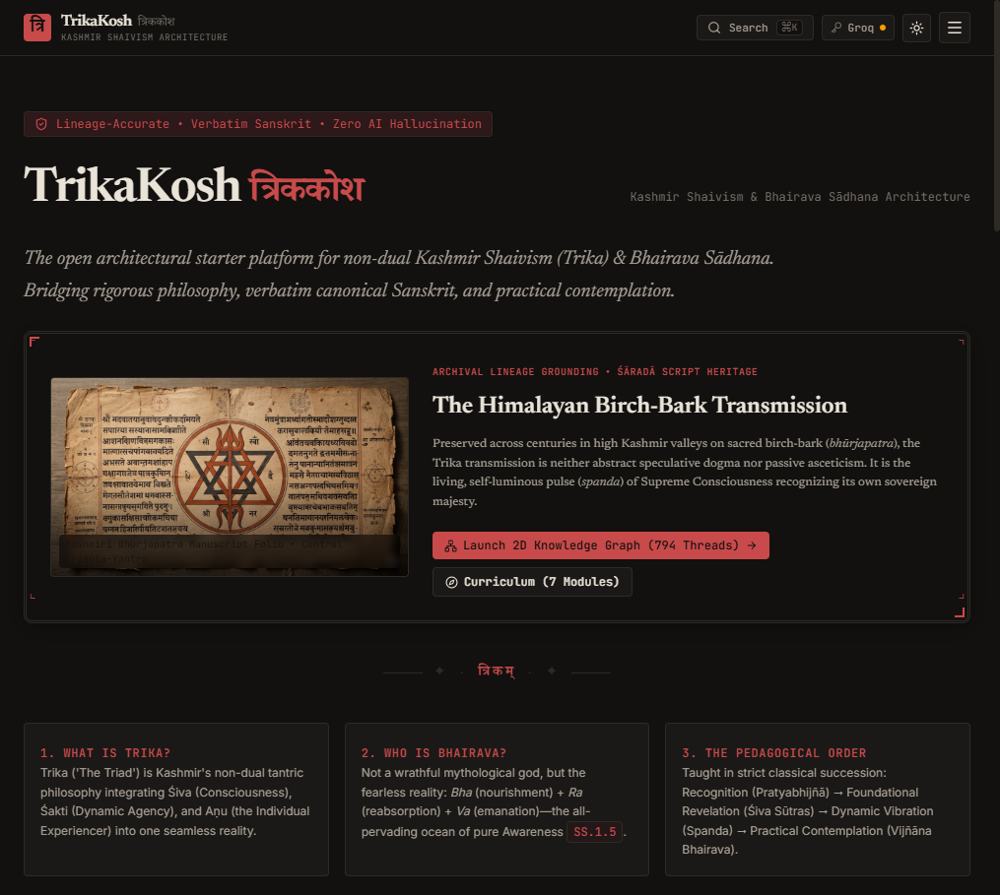
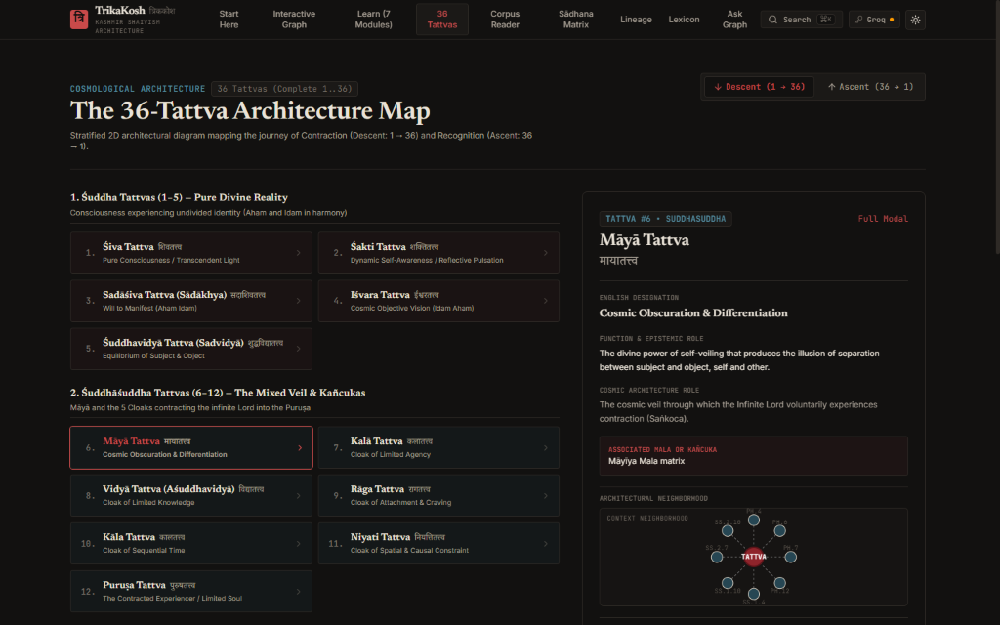
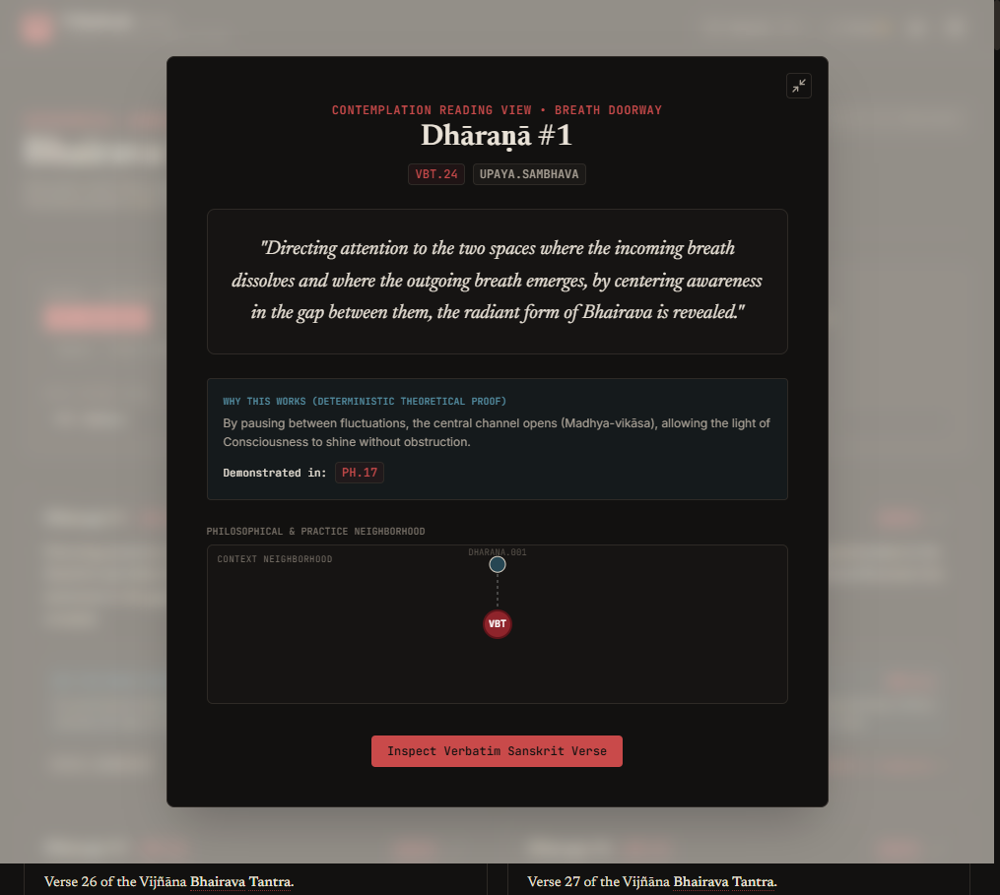
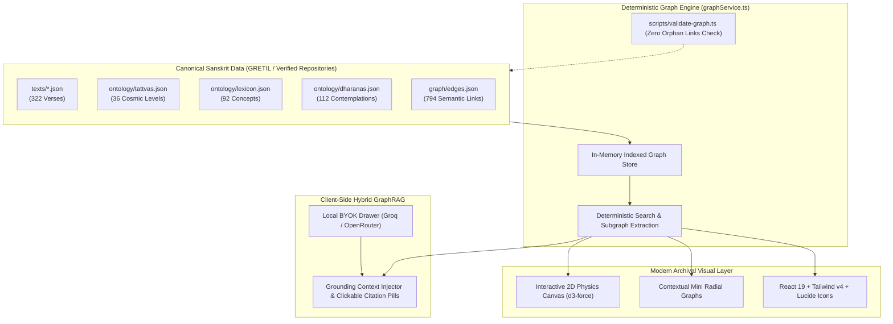

# TrikaKosh (त्रिककोश)

> **The Definitive Open Starter Platform & 2D Knowledge Graph for Kashmir Shaivism (Trika) & Bhairava Sādhana**

[](https://trikakosh.pages.dev)
[](https://www.typescriptlang.org/)
[](https://react.dev/)
[](https://tailwindcss.com/)
[](scripts/validate-graph.ts)
[](LICENSE)

---

## 🏛️ Overview

**TrikaKosh** (`त्रिककोश`, "The Treasury of Trika") is a fast, lineage-accurate, 100% deterministic interactive web platform designed to be the premier open resource for non-dual **Kashmir Shaivism** and **Bhairava Sādhana**.

It directly bridges the triad:
$$\text{Rigorous Philosophy} \longleftrightarrow \text{Verbatim Sanskrit} \longleftrightarrow \text{Practical Bhairava Contemplation}$$

Everything is structured in the exact pedagogical order established by the master scholars of the tradition—**Vasugupta, Somānanda, Utpaladeva, Abhinavagupta, and Kṣemarāja**—with zero watered-down New Age dilution, zero AI hallucination, and zero opaque academic gatekeeping.



---

## 🌟 Core Pillars & Key Features

### 1. 🕸️ 2D Interactive Relationship Graph (`/#/graph`)
A custom 60 FPS HTML5 Canvas engine driven by `d3-force` simulation modeling the interconnected universe of Trika Shaivism:
- **582 Nodes ("Balls")**: Scaled by degree and color-coded across 8 canonical classes:
  - 🔴 **Texts & Masters** (`#8F242B` — Sindoor Red)
  - 🟡 **36 Cosmic Tattvas** (`#D9A05B` — Aged Ochre)
  - 🔵 **Philosophical Concepts** (`#264653` — Himalayan Slate)
  - 🟠 **112 Dhāraṇās** (`#C94A4A` — Sacred Terracotta)
  - ⚫ **Upāyas & Malas** (`#4A4A4A` — Charcoal / Ash)
  - 🟣 **322 Canonical Verses** (`#B85D63` — Rose)
- **794 Relationship Threads**: Fully typed semantic links (`EXPLAINS_CONCEPT`, `MAPS_TO_TATTVA`, `GROUNDED_IN`, `USES_UPAYA`, `OVERCOMES_MALA`) with animated hover pulses.
- **Interactive Controls**: Real-time search with instant auto-centering, Category filters, Freeze/Unfreeze simulation, Zoom-to-Fit, and **Ego-Focus Mode** (isolates any active node and its direct 1-hop neighborhood).
- **Sliding Node Inspector Drawer**: Inspect verbatim Devanagari, IAST transliteration, study glosses, and connected relationships without losing spatial context.


---

### 2. 🌌 36-Tattva Cosmic Map (`/#/tattvas`)
An interactive architectural explorer of Kashmir Shaivism’s 36 cosmic levels of reality:
- **Dual Perspectives**: Toggle between **Descent (*Sṛṣṭi*)** (how Universal Consciousness contracts into individual experience) and **Ascent (*Saṃhāra*)** (how the individual ascends back to sovereign freedom).
- **Three Structural Orders**:
  1. *Śuddha Tattvas (1–5)* — Pure Divine Reality (*Śiva, Śakti, Sadāśiva, Īśvara, Śuddhavidyā*).
  2. *Śuddhāśuddha Tattvas (6–12)* — The Veil (*Māyā*) and the 5 Cloaks of limitation (*Kañcukas*: *Kalā, Vidyā, Rāga, Kāla, Niyati*).
  3. *Aśuddha Tattvas (13–36)* — Individual Soul (*Puruṣa*), Nature (*Prakṛti*), intellect, senses, subtle essences, and gross elements.
- **Contextual Mini Graphs**: Embedded `<RelationshipGraphMini />` in the inspector drawer revealing the architectural neighborhood and verified verses mapped to each tattva.



---

### 3. 🔥 Bhairava Sādhana Contemplation Matrix (`/#/sadhana`)
A distraction-free contemplation laboratory indexing all **112 meditative doorways (*dhāraṇās*)** from the canonical *Vijñāna Bhairava Tantra*:
- **Faceted Filters**: Filter by the 3 Upāyas (*Śāmbhava, Śākta, Āṇava*) and natural sensory doorways (Breath / *Prāṇa*, Gaps / *Madhya*, Sound / *Nāda*, Emotion & Intensity, Gaze & Light, Space / *Vyoma*, Body Sensation).
- **Contemplation Reading View Modal**: Fullscreen quiet contemplation view displaying:
  - Exact meditative practice instructions.
  - **Why This Works (Deterministic Theoretical Proof)**: The underlying metaphysical mechanism verified against foundational sūtras.
  - **Embedded Mini Graph**: Visualizing the direct philosophical and experiential neighborhood.



---

### 4. 📜 The 4-Text Pedagogical Initiation Sequence (`/#/texts`)
Trika texts are not meant to be read randomly. TrikaKosh arranges them in the classical pedagogical order prescribed by the tradition:
1. **Stage 1: *Pratyabhijñāhṛdayam* (प्रत्यभिज्ञाहृदयम्)** — 20 Sūtras by *Kṣemarāja*. The essential philosophical foundation explaining how Consciousness contracts and recognizes itself.
2. **Stage 2: *Śiva Sūtras* (शिवसूत्राणि)** — 77 Sūtras across 3 *Unmeṣas* revealed to *Vasugupta*. Mapped directly to the three Upāyas.
3. **Stage 3: *Spanda Kārikās* (स्पन्दकारिकाः)** — 53 Kārikās across 4 *Niḥsyandas*. The dynamic pulse, vibration, and ecstasy of reality.
4. **Stage 4: *Vijñāna Bhairava Tantra* (विज्ञानभैरवतन्त्रम्)** — 162 Verses / 112 Dhāraṇās. The experiential contemplative laboratory.
5. **Bonus Canonical Hymn: *Bhairavastotra* (भैरवस्तोत्रम्)** — 10 ecstatic non-dual verses composed by *Abhinavagupta*.

---

### 5. ⚖️ The "False Friends" Disambiguator
A side-by-side comparative table dispelling widespread misconceptions between Kashmir Shaivism, Classical Advaita Vedānta, and Patañjali Classical Yoga:
- **The World (*Jagat*)**: Real divine projection (*Ābhāsa*), not an inexplicable illusion (*Māyā/Mithyā*).
- **Ultimate Reality**: Dynamic Consciousness with Sovereign Freedom (*Svātantrya* and *Vimarśa*), not static, passive luminescence.
- **Who is Bhairava?**: The fearless non-dual ground of reality (*Bha* = maintenance, *Ra* = withdrawal, *Va* = manifestation), not a wrathful cemetery deity.
- **Emotion & Desire**: Kinetic forms of Śakti to be recognized at the moment of arising, not toxic impurities to be suppressed.
- **Liberation (*Mokṣa*)**: Embodied divine celebration (*Jīvanmukti / Sāmarasya*), not escape from the physical world.

---

### 6. 🧭 Guided Curriculum: "Zero to Trika in 7 Modules" (`/#/learn`)
A structured introductory pathway with persistent progress tracking, rich typography, interactive term hover cards, and canonical verse citations.

---

### 7. 🤖 Hybrid GraphRAG Q&A (Deterministic First + BYOK Synthesis) (`/#/ask`)
- **Deterministic-First Search**: Retrieves canonical verses and definitions via client-side 1-to-2 hop graph traversals over `edges.json`.
- **Bring Your Own Key (BYOK)**: Supports **Groq** and **OpenRouter** endpoints. API keys are stored solely in client `localStorage` with zero telemetry.
- **Hallucination-Free Synthesis**: Prompts strictly force the LLM to cite verbatim verse IDs (`[PH.1]`, `[VBT.24]`) rendered as clickable inspector pills.
- **Offline / Zero-Key Mode**: Gracefully works 100% deterministically without any key.

---

## 🏗️ Architecture & Data Integrity



### Deterministic Ingestion & Verification
- **Zero Sanskrit Fabrication**: All Devanagari and IAST verses originate from verified public-domain editions with SHA-256 integrity checks in `data/provenance.json`.
- **Copyright Integrity**: Pairings feature original word-by-word breakdowns (*padaccheda*) and study glosses; no modern copyrighted translations are replicated.
- **Graph Consistency Gate**: Running `npm run validate:graph` verifies that 100% of nodes, edges, tattvas (1..36 sequence), and dharanas (1..112 sequence) resolve without dangling references.

---

## 🚀 Quickstart & Local Development

### Prerequisites
- Node.js `v18+` or `v20+`
- npm `v9+`

### Installation
```bash
# Clone the repository
git clone https://github.com/HimanshuMohanty-Git24/trikakosh.git
cd trikakosh

# Install dependencies (under 5 seconds)
npm install

# Start local development server with Vite HMR
npm run dev
```

Visit `http://localhost:5173/` in your browser.

---

## 🧪 Verification & Build Commands

```bash
# Verify 100% deterministic graph integrity (nodes, edges, tattvas, dharanas)
npm run validate:graph

# Typecheck with TypeScript strict rules
npm run typecheck

# Build optimized production bundle
npm run build

# Preview production build locally
npm run preview
```

---

## 🌐 Free Global Deployment

TrikaKosh is optimized for **Cloudflare Pages**:
```bash
# One-time login
npx wrangler login

# Deploy production build to Cloudflare Edge
npx wrangler pages deploy dist --project-name trikakosh --branch master
```

---

## 🪷 Traditional Lineage & Ethics Notice

The Kashmiri lineage strictly distinguishes between two domains:
1. **Universal Contemplation & Philosophical Study**: The study of *Pratyabhijñā*, the nature of Awareness, and the 112 mindfulness doorways of the *Vijñāna Bhairava Tantra* are universally accessible to all earnest practitioners.
2. **Initiated Tantric Rituals & Secret Mantras**: Historically require *dīkṣā* (formal spiritual initiation) and personal oversight from a living master.

TrikaKosh is built to honor this boundary with total scholarly and lineage integrity.

---

## 📄 License

This open platform is released under the **MIT License**. All canonical Sanskrit root texts belong to the public domain. Original architectural structure, ontology mappings, and study glosses are freely shared for the elevation of human contemplation.
